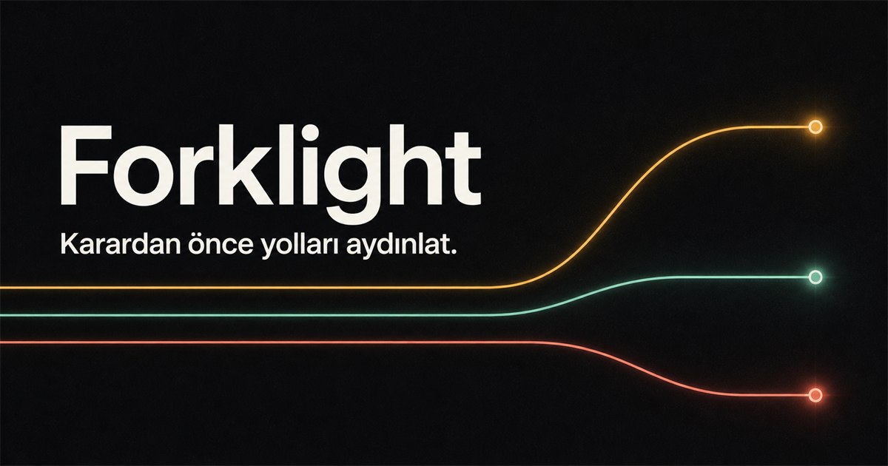

# Forklight

 

**Forklight, önemli bir kararı üç olası gelecek üzerinden prova edip hazırlığını şeffaf matematikle görünür kılan yerel öncelikli bir web uygulamasıdır.**

[Canlı uygulamayı aç](https://muhammetefesahan.github.io/Forklight/)



## Ne işe yarar?

Bir karar yazın; iyimser, ana ve ters yol için olasılık, etki, kontrol alanı, erken sinyal ve hazırlık hamlesi belirleyin. Forklight girdiler değiştikçe şu görünümü canlı olarak üretir:

- Hazırlık skoru (0–100)
- Eyleme dönük risk maruziyeti bandı
- Kontrol alanı bandı
- Tamamlanan senaryo sayısı
- Kullanıcının belirlediği yeniden değerlendirme sinyali

Skor bir gelecek tahmini değildir. Ondalıklı sahte hassasiyet kullanmaz ve formülü arayüzde açıkça gösterir.

## Gizlilik modeli

- Hesap, sunucu, analitik ve izleme yoktur.
- Kararlar yalnızca tarayıcının `localStorage` alanında tutulur.
- Uygulama kaynaklarında dış API, XHR veya WebSocket çağrısı yoktur.
- CSP politikası `connect-src 'none'` ile dış bağlantıları tarayıcı düzeyinde engeller.
- JSON içe aktarımı 1 MB ile sınırlıdır ve yalnızca izin verilen alanlar normalize edilir.
- İstenirse DevTools → Network açılarak hiçbir dış ağ çağrısı olmadığı doğrudan doğrulanabilir.

## Açıklanabilir hesaplama

Her yolun hazırlığı:

```text
(dolu senaryo/sinyal/hamle oranı × 70) + (kontrol ÷ 5 × 30)
```

Toplam hazırlık, üç yolun ortalamasıdır. Risk maruziyeti yalnızca olumsuz etkiye sahip yollar için hesaplanır:

```text
olasılık × |olumsuz etki| × ((6 - kontrol) ÷ 5)
```

Katkılar üç yola bölünür ve en yakın tam sayıya yuvarlanır.

## Özellikler

- Tek ekran ve mobil uyumlu çalışma yüzeyi
- Klavye ve dokunmatik kontrollere uygun slider alanları
- Renk yanında metin ve sembolle güçlendirilmiş durumlar
- Ekran okuyucuya bildirilen dışa aktarma geri bildirimi
- Geri alınamaz temizleme işlemi için onay penceresi
- JSON ve Markdown içe/dışa aktarma
- Çevrimdışı kullanım için service worker
- Bağımlılıksız HTML, CSS ve JavaScript

## Çalıştırma

Projeyi herhangi bir statik dosya sunucusuyla açın. Derleme veya bağımlılık kurulumu gerekmez.

```bash
python -m http.server 4190
```

Testler Node.js'in yerleşik test çalıştırıcısını kullanır:

```bash
npm test
```

## Tasarım süreci

Ürün akışı ve açıklanabilirlik yaklaşımı ayrı bir kalite turunda eleştirildi. Mobil UX, erişilebilirlik, mikro metinler ve görünür gizlilik kanıtları ikinci turda güçlendirildi. Nihai kapsam, formüller ve kod uygulanıp test edildi.

## Lisans

[MIT](./LICENSE)
